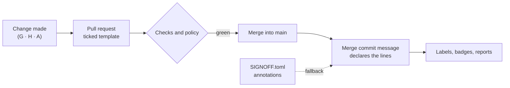

# Concepts overview

The playground rests on a few ideas: every change says how it was made and checked, the answer is stored with the files, and automatic checks enforce it. This page maps those ideas and links to the page for each.

## The G/H/A scheme

Every change answers three questions: how much AI generated it (G0 to G3), how a human checked it (H0 to H3), and whether an independent AI checked it (A0 to A3). The answers are written in one line, for example `G2 · H1 · A0`. A2 and A3 also need an `AI-Review-Findings:` line. The person who opens the pull request is responsible for what they declare.

See [Generation, human review and AI review levels](declaration-levels.md).

## Where declarations live

A declaration can come from several places: annotations in `SIGNOFF.toml` (a default for `**` and entries for single paths or folders), commit and pull request descriptions, attestations for reviews of existing files, and entries for single commits. When several sources apply to a file, precedence rules decide which one wins.

See [Where declarations are kept](where-declarations-live.md).

## Line-level history

With `[history]` enabled, each line takes the declaration of the commit that landed it on `main`. The annotations in `SIGNOFF.toml` are the fallback for lines whose commit declares nothing. A pull request's ticked template becomes the merge commit message, which is how the declaration reaches git. The `merge-method` setting says how pull requests land: `merge`, `squash` or `rebase`.

See [Line-level declarations and merge methods](line-level-history.md).

## Policy

The `[policy]` table sets minimum review levels. In this repository every file needs at least H1, and G3 also needs at least A1. A change below the minimum fails the check.

See [Policy: minimum review levels](policy.md).

## Snapshots and freezing

`aisignoff freeze` writes the declarations worked out so far into `SIGNOFF.snapshot.json`. Frozen lines keep their levels even if the annotations in `SIGNOFF.toml` change later.

See [Snapshots and freezing declarations](snapshots-and-freeze.md).

## Checks, labels, badges and reports

The File-signoff and PR-signoff workflows check that every file is declared and that the policy is met. PR-signoff also sets `ai:G*`, `human:H*` and `ai-review:A*` labels. On `main`, badges and a folder report summarise the levels of the files and of the merged pull requests.

See [Labels, badges and reports](labels-badges-and-reports.md).

## How the ideas fit together

For the practical side, see the [usage pages](../usage/index.md).
