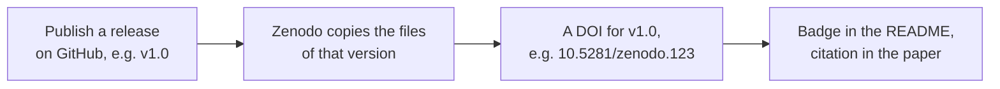

[← 4 Hands-on](04-hands-on.md) · **5 Releases and DOIs** · [Cheat sheet →](cheat-sheet.md)

# 5 · Releases and DOIs with Zenodo

[Zenodo](https://zenodo.org) is CERN's free research archive. Connected to GitHub, it archives **every
release** of a repository and gives it a **DOI**, so the exact files behind a paper can be cited and stay
findable even if the repository moves or disappears.

## Once per repository (5 minutes)

1. Log in at <https://zenodo.org> with **Log in with GitHub**.
2. Open your account menu → **GitHub**. Click **Sync now**, find the repository and switch it **On**.
   For a repository of the organisation you need admin rights on it, and the organisation may first have to
   allow Zenodo (GitHub asks when you log in).
3. Put a **`CITATION.cff`** file in the repository: who the authors are, the title, the licence. GitHub then
   shows **Cite this repository** in the sidebar, and Zenodo takes its metadata from the file.
   This repository has one: [CITATION.cff](../CITATION.cff).

The repository must be **public**, and it should have a licence (a `LICENSE` file, or `license:` in
`CITATION.cff`) so people know what they may do with the files.

## Every release (2 minutes)

1. **Releases → Draft a new release** (on the front page, right-hand side).
2. **Choose a tag** → type a new version, e.g. `v1.0.0` → **Create new tag**.
3. A title, and a few lines on what's new (**Generate release notes** writes a list of the merged pull requests).
4. **Publish release.**

A few minutes later Zenodo has archived it, and the DOI is on your Zenodo upload page. You get two kinds:

| DOI | Points to | Use it for |
|---|---|---|
| **Version DOI** | exactly this release, e.g. v1.0.0 | a paper: the files you actually used |
| **Concept DOI** | always the newest release | the README badge, "cite this software" |

## Badge and citation

- On the Zenodo record, click the **DOI badge** and copy the Markdown into the top of the README:
  ``.
  [aisignoff's own README](https://github.com/industrial-mathematics-group/aisignoff) has one.
- Add the concept DOI under `identifiers:` in `CITATION.cff`, so **Cite this repository** gives it too.

## Where AI signoff comes in

- `SIGNOFF.toml` is a file in the repository, so it is **archived with every release**: the declarations of
  the files go to Zenodo too.
- The declarations of single pull requests live in the git history, which Zenodo doesn't archive. Before a
  release, a maintainer can take a **snapshot** (`aisignoff freeze`), which writes them into a file,
  `SIGNOFF.snapshot.json`, that is archived as well.
- In this repository every published release also gets the **AI signoff report** attached by a workflow
  (`aisignoff-report.html`, `.txt` and `.json` under the release's *Assets*), so anyone can see how that
  version was made and reviewed without cloning anything.

## Good to know

- **A published DOI is permanent.** Zenodo records can't be deleted, only followed by newer versions. To
  practise, use the [Zenodo Sandbox](https://sandbox.zenodo.org), which works the same with test DOIs.
- Only **published releases** are archived; drafts aren't, and ordinary pushes and merges never are.
- Don't put anything in a release you couldn't publish: it will be public for good.

---

[← 4 Hands-on](04-hands-on.md) · [Cheat sheet →](cheat-sheet.md)
